


<picture>
  <source media="(prefers-color-scheme: dark)" srcset="assets/header-about.svg" />
  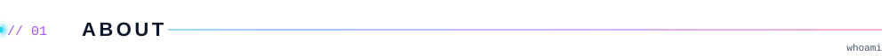
</picture>

I build AI systems that run in production: multi-camera video pipelines on NVIDIA GPUs, and
LLM applications with retrieval, agents and fine-tuned models, served behind real APIs with tests,
metrics and deployment. Every project here is public, reproducible and measured.

<picture>
  <source media="(prefers-color-scheme: dark)" srcset="assets/header-stack.svg" />
  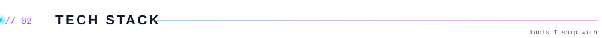
</picture>


<picture>
  <source media="(prefers-color-scheme: dark)" srcset="assets/header-projects.svg" />
  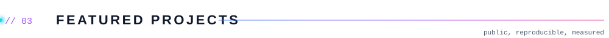
</picture>

<a href="https://github.com/joecodeai/streamsight">
  
</a>

<a href="https://github.com/joecodeai/ledgerline">
  
</a>

<b>More detail on each project</b>

 

| | What it shows | Stack |
|---|---|---|
| [**StreamSight**](https://github.com/joecodeai/streamsight) | Real-time CV at scale: YOLO11 on TensorRT, ByteTrack-style tracking, OSNet re-id across cameras with Milvus, pose-based fall alerts, a DeepStream 8 pipeline with a C++ parser, detector benchmarks across TensorRT / ONNX Runtime / OpenVINO | PyTorch, TensorRT, DeepStream, GStreamer, FastAPI, PostgreSQL, Prometheus, Docker, Kubernetes |
| [**Ledgerline**](https://github.com/joecodeai/ledgerline) | Production LLM engineering: tool-calling agent with RBAC and audit, hybrid RAG over SEC 10-Ks, LoRA fine-tuned text-to-SQL, fraud detection, injection and PII guardrails, MCP server, signed webhooks, evals for every component | FastAPI, Redis Stack, PostgreSQL, Ollama, PEFT, Next.js, Playwright, Helm, Terraform (GCP) |
| [**EMGHandNet**](https://github.com/joecodeai/EMGHandNet) | Research: hand-gesture classification from 12-channel surface EMG (Ninapro DB2, 50 classes) with a CNN + BiLSTM, 87.1% test accuracy | TensorFlow, NumPy |

<picture>
  <source media="(prefers-color-scheme: dark)" srcset="assets/header-activity.svg" />
  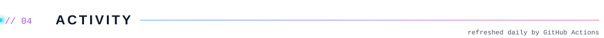
</picture>


<picture>
  <source media="(prefers-color-scheme: dark)" srcset="https://raw.githubusercontent.com/joecodeai/joecodeai/output/snake-dark.svg" />
  
</picture>

<picture>
  <source media="(prefers-color-scheme: dark)" srcset="assets/header-connect.svg" />
  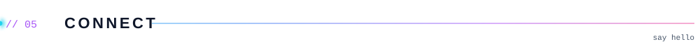
</picture>

<!--
  Add more links here when they exist. Same badge style:
  Email:     
  Portfolio: 
  X:         
  Instagram: 
-->

  

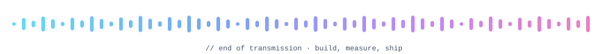

